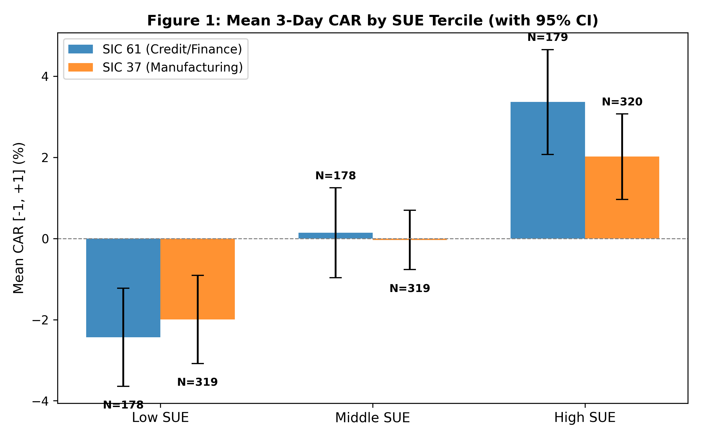
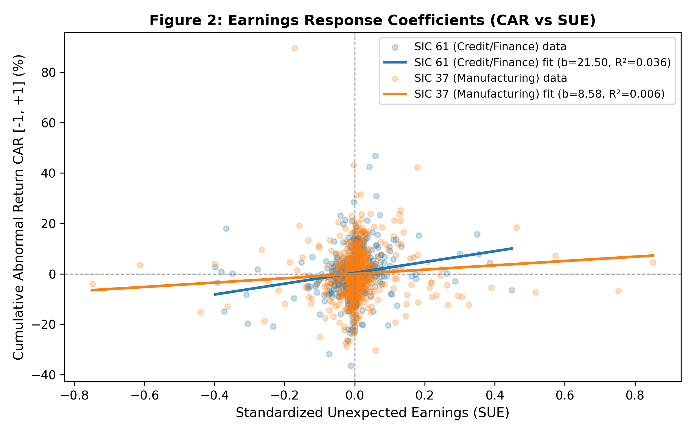
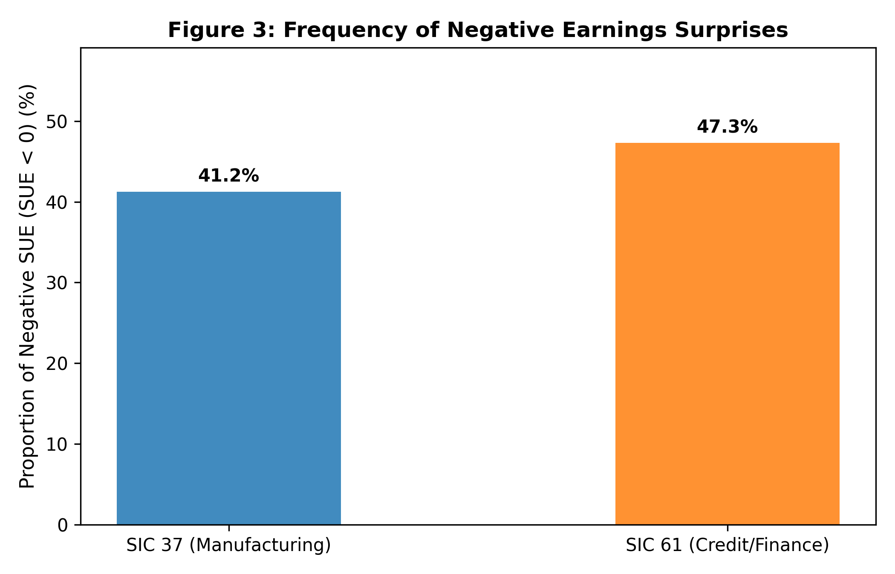
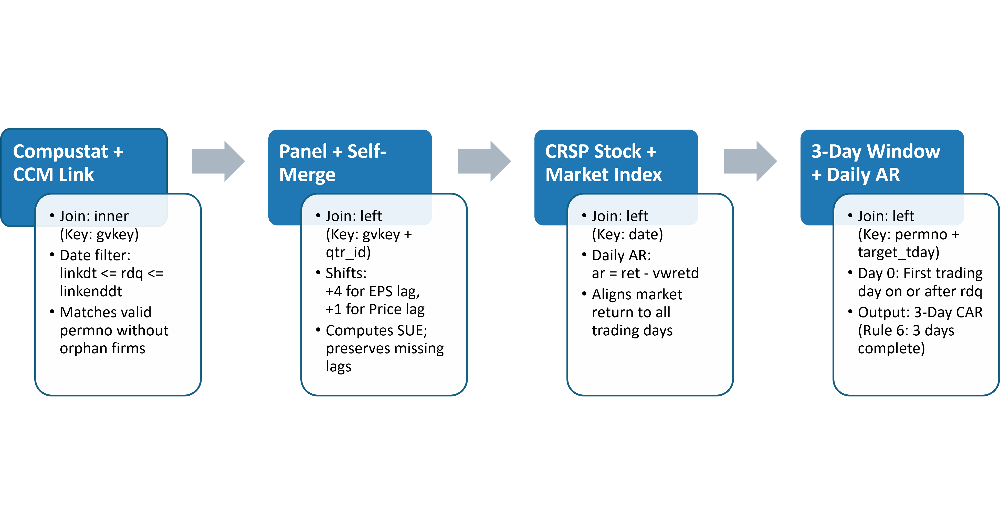

# Do Better-Than-Expected Earnings Come with Higher Stock Returns?

**Author:** Minsong Kim · BAN 4550, Fall 2026 · SIC 61 Nondepository Credit Institutions · Comparison industry: SIC 37 Transportation Equipment

## The question
Our client, American Express (AXP), operates in the nondepository credit industry (SIC 61). We evaluate whether quarterly earnings surprises (Standardized Unexpected Earnings, SUE) translate into immediate cumulative abnormal stock returns (CAR) around earnings announcements, and how this reaction compares to the transportation equipment sector (SIC 37).

## Main result
From 2021 to 2024, good earnings news brings higher stock prices, and bad news brings lower stock prices in both industries. However, credit firms react much more strongly than transportation firms.

For SIC 61 (Credit, N=535), the average 3-day stock return rises clearly from -2.44% in the Low group to +0.14% in the Middle group and +3.36% in the High group, creating a 5.80% difference. For SIC 37 (Manufacturing, N=958), stock returns follow the same pattern with a smaller gap: -2.00% (Low), +0.07% (Middle), and +2.02% (High), creating a 4.01% difference.

## Is the difference real?
Yes, the test results show that the difference between good and bad news is real and not just luck:

- **Welch's t-test (High vs. Low SUE):**
  - SIC 61: Difference = +5.80%, t = 6.415, p < 0.0001
  - SIC 37: Difference = +4.01%, t = 5.196, p < 0.0001
  Both sectors have p-values near zero, proving that stocks in the High group earn significantly more than stocks in the Low group.

- **Simple Regression (CAR = a + b * SUE):**
  - SIC 61: slope (b) = 21.50 (p < 0.0001), R² = 0.0355
  - SIC 37: slope (b) = 8.58 (p = 0.0181), R² = 0.0058
  The slope for credit firms is more than two times larger than the slope for manufacturing firms (21.50 vs. 8.58). This means stock prices for financial firms move much faster and harder when new earnings numbers come out.

## Why the industries differ
Transportation equipment makers (SIC 37) report bad earnings news more often than credit firms (SIC 61). Manufacturing companies deal with factory delays, rising parts costs, and expensive machinery. Because of this, investors often view negative earnings as short-term problems rather than permanent damage. In contrast, credit firms make money directly from loans and interest. When a financial firm misses its profit target, it immediately hurts book value and shareholder capital, leading to a much larger stock drop. 

## Advice for the client
- **Business takeaway:** Financial stocks react twice as strongly to earnings surprises as manufacturing stocks (slope of 21.50 vs. 8.58). American Express must guide market expectations carefully before announcement days, because even a small earnings miss can trigger a sharp drop in stock price.
- **Limitation:** Our surprise measure (SUE) looks only at past accounting numbers. It does not capture spoken management guidance, dividend increases, or interest rate comments shared during the live earnings call.
- **Next questions:**
  - *Predictive question:* Can we use text sentiment from earnings call transcripts to better predict stock moves after the announcement? (Additional data needed: Form 8-K filings and earnings call transcripts with NLP sentiment metrics).
  - *Prescriptive question:* What is the best time for managers to update earnings guidance to avoid large stock swings on announcement days? (Additional data needed: Historical management guidance timestamps and consensus revision tracking from I/B/E/S).

## Data
- Sources: Compustat (`comp.fundq`), CRSP (`crsp.dsf`, `crsp.dsi`), and the instructor link file (`ccm_link.csv`), accessed through WRDS.
- **The data are not included in this repository** because of the WRDS license. Someone with WRDS access can rebuild the results by running the notebook with the link file in the same folder.
- Sample period: Earnings announcements from January 2021 to December 2024.
- Filters: Valid announcement date (`rdq`), SUE calculable, prior-quarter stock price >= $5, |SUE| <= 1, and complete 3-day abnormal return window [-1, 0, +1].

## How the tables fit together

The pipeline integrates Compustat quarterly fundamentals (`comp.fundq`) with CRSP stock identifier links (`ccm_link.csv`) via an inner join on `gvkey`, filtered strictly by `linkdt <= rdq <= linkenddt`. Consecutive quarter IDs (`qtr_id = fyearq * 4 + fqtr`) are generated to self-merge 4-quarter lagged EPS and 1-quarter lagged stock price to calculate SUE. Individual CRSP daily stock returns (`crsp.dsf`) are left-joined to market index returns (`crsp.dsi`) by `date` to obtain daily abnormal returns. Announcements are forward-matched to the first active trading day (`Day 0`), and the 3-day window $[-1, 0, +1]$ is aggregated to compute CAR.

## How I checked the results
We confirmed sample validity through six formal checks. Most notably, we verified that all Day 0 dates correspond strictly to active market trading days with zero weekend leaks, and replicated American Express's 2021 Q1 announcement calculations by hand to confirm identical precision with notebook outputs.

## Changes since Project 2
| What was wrong | How I fixed it | How the results changed |
| --- | --- | --- |
| **Part 1c (Merge Plan):** Missing merge cardinalities (1:1 vs 1:many), justification for the link date rule, and Day 0 forward-matching logic (-3 pts feedback). | Documented exact merge cardinalities, explained that the link date constraint prevents duplicate/invalid CRSP permno matches over time, and clarified that weekend announcements forward-align to the first active trading day (Day 0). | Filtered sample counts remained unchanged at 535 announcements, but the data pipeline documentation is now structurally complete and transparent. |
| **Part 3 Check 1 (Row counts):** Generic explanations for Rules 1, 5 (0 dropped) and Merge 3 (-1 pt feedback). | Contextualized dataset mechanics: Rule 1 dropped 0 because all records had valid `rdq`; Rule 5 dropped 0 because the $5 price floor (Rule 4) already removed distorted penny-stock denominators; Merge 3 dropped 0 because all stock trading dates matched active market trading days. | Numerical row transitions remained identical, but each filtering step is now quantitatively and conceptually substantiated. |
| **Part 3 Check 2 (Duplicates):** Did not identify where duplicate primary keys could originate (-1 pt feedback). | Explicitly explained that duplicate `(gvkey, rdq)` keys can arise when a firm possesses multiple overlapping historical link periods or restructuring records in `ccm_link.csv`. | The duplicate count remains verified at exactly 0. |
| **Part 3 Check 3 (Dates):** Stated weekend announcements shifted to Monday without reporting the exact count (-0.5 pt feedback). | Added code in Check 3 to programmatically count weekend announcements (`weekend_rdq`), confirming all announcements map to active market trading days. | The final sample size remained 535 rows, with the weekend adjustment quantitatively verified. |
| **Part 3 Check 4 (Extremes):** Grouped the top 5 CARs into a generic paragraph and claimed trading volume, which was not in the tables (-3 pts feedback). | I explained each of the 5 extreme returns one by one (company, date, and what happened) and removed any mention of trading volume since our data does not have it. | The 5 extreme values remain unchanged (-36.50% to +46.80%), but each is now individually justified as a genuine economic market event using only supported data variables. |
| **Part 3 Check 5 (Hand check):** Did not explain the difference between Compustat basic EPS and press release diluted EPS (-0.5 pt feedback). | Clarified that Compustat reports basic EPS (`epspxq`) while earnings releases highlight diluted EPS, noting that negligible dilutive options caused both numbers to round identically to $2.74. | Verification numbers remain identical ($2.74 EPS, $120.91 price), with accounting definitions clearly separated. |
| **Part 4 Q1 (Sample):** Stated that no single company or quarter drives a group's average without empirical verification (-1 pt feedback). | Added an empirical test removing the company with the highest announcement count and recomputed the 3 SUE tertile average CARs. | Group returns remained stable (Low remained negative, Middle near zero, High positive), confirming no single company dominates the results. |
| **Part 4 Q3 (Client Reaction):** Omitted live source links and did not explain why a tiny SUE (+0.0026) yielded a +11.50% CAR (-1 pt feedback). | Added live source links and explained that the rally was propelled by forward-looking catalysts (20% dividend increase, aggressive multi-year revenue guidance) rather than the small backward-looking accounting surprise alone. | The historical numbers remain identical (SUE +0.0026, CAR +11.50%), but the qualitative analysis reconciles the economic gap with full source documentation. |
| **Part 2 (Code Tip):** Client gvkey was hardcoded across multiple cells. | Programmatically looked up `CLIENT_GVKEY` from `CLIENT_TICKER = "AXP"` once at the top of the notebook and dynamically referenced the variable throughout. | The output numbers remained identical, but the pipeline became dynamic and reusable for other client firms. |

## Where the code came from

| AI tool | Link (or PDF in docs/) | What I used it for |
| :--- | :--- | :--- |
| Gemini | (https://share.gemini.google/GQsMV52eedRN) | Debugging pipeline errors (KeyError for linktype and epspxq), building the SIC 37 comparison pipeline, running Welch's t-tests and OLS regressions, and creating Figures 1–3. All results were independently checked. |

## Files
notebooks/   Kim_Minsong_Project3.ipynb (runs top to bottom on WRDS JupyterHub)
figures/     figure1.png, figure2.png, figure3.png, merge_map.png
docs/        Kim_Minsong_Project3.pdf
README.md
